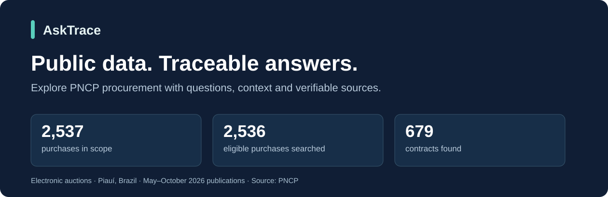
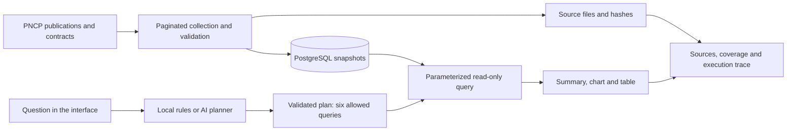

# AskTrace

**Prepare a procurement analysis: compare publications, choose what to inspect and take the sources.**

[Português](README.md) · [Case study](docs/case-study.md) · [Architecture](docs/architecture.md) · [Documentation](docs/README.md)



[](https://github.com/luizznelson/asktrace/actions/workflows/quality.yml)

AskTrace is an assistant for exploring a historical dataset from Brazil's National
Public Procurement Portal (PNCP). Its proposed audience is **analysts preparing public
procurement monitoring reports**: understand publication patterns and check records
before including a conclusion in a report. This audience is a product hypothesis; no
user interviews, organizational adoption or productivity measurement have taken place.

## The proposed business problem

When preparing a report, the question is: **“Where should I start the analysis, and what
data supports the findings I will present?”** AskTrace combines comparisons by purchasing
organization, municipality and month, lookup of an identified purchase, and contextual
exports. The output supports human analysis, without automatically ranking investigative
priorities or classifying irregularities.

[PNCP already provides search, filters, documents, dashboards and open data](https://www.gov.br/pncp/pt-br/pncp).
This application complements those resources with questions over a bounded historical
dataset. A market gap, commercial demand or advantage over the portal has not been
validated with users. [Business rationale, sources and validation plan](docs/business-case.md) (Portuguese).

## From a question to an analysis decision

| Reporting need | Supported question | How to use the result |
| --- | --- | --- |
| Choose where to look more closely | Which organizations or municipalities have more purchases? | Compare publication volumes; rankings contain up to 20 groups |
| Describe the period | How do purchases vary by publication month? | Present the monthly series without treating publication as payment |
| Inspect an identified purchase | Trace a purchase by its PNCP ID | Examine linked contracts and provenance; an explicit ID is required |
| Explain the report's limitations | How complete are the fields? | Show unknown fields and coverage without replacing missing values with zero |

**Journey:** check scope → compare publications → look up a purchase by ID → verify
sources → export CSV/JSON. Queries are independent: rankings do not open a filtered list
of an organization's purchases. The user selects the record to inspect.

## The role of AI

AI interprets a Portuguese question and selects one of six allowed queries. The database
provides calculations and numerical answers. A local rules mode supports the same catalog
without an external API. The added value of natural language still needs a user-task
comparison with that mode. This is not a RAG system. The interface supports Portuguese and
English; questions are supported in Portuguese. The application currently runs locally.

## Try an investigation

| Ask in Portuguese | What you receive | How to verify |
| --- | --- | --- |
| Como evoluíram as compras por mês de publicação? | Calculated summary, six-month chart and table | June has 527 publications; the series totals 2,537 purchases |
| Quais órgãos têm mais compras na base? | Up to 20 purchasing organizations, with a first-five preview | Organization CNPJ, estimates and missing-value counts |
| Rastreie a compra 00394452000103-1-011584/2026. | Purchase details and linked contracts | Identifiers, source indexes and page hashes |

Coverage overview, municipalities and data completeness are also available. Summaries
and charts use the returned rows without a second AI call. JSON and CSV preserve scope
and original values.

## Verified deliverables: data coverage

| Default scope: May–October 2026 publications, method 6, units in Piauí | Count |
| --- | ---: |
| Purchases in the dataset | 2,537 |
| Eligible purchases searched for contracts | 2,536 |
| Contracts linked to 370 purchases | 679 |
| Searched purchases returning no contract publication | 2,166 |
| Eligible searches pending | 0 |
| Invalid-source-year exclusion | 1 |

These are snapshot counts, not financial impact metrics. Publication does not establish
payment; no returned publication does not establish absence of a contract. The 1,354
unreported awarded amounts remain unknown. The original August–October snapshot stays
separate and is never added to the default dataset.

[Coverage and database verification](docs/contracts-expanded-coverage.md) · [Interpretation limits](docs/analytics.md) (Portuguese)

## How it works



The model selects a reviewed query; it does not write SQL or generate the numerical
answer. Database results are not sent to the planner. Local rules support the same six
paths without an external API. Tab history is not model conversation memory and marks
results from earlier dataset versions.

## Engineering decisions

| Decision | Failure prevented | Evidence |
| --- | --- | --- |
| Decimal → NUMERIC → decimal text | Precision loss and treating missing amounts as zero | [Queries](asktrace/query.py), [formatting](web/formatters.js) |
| Hashes, snapshots and idempotent loading | Silent source changes and duplicate loading | [Integrity](asktrace/evidence.py), [completed coverage](docs/contracts-expanded-coverage.md) |
| Validated plans and a read-only login | Unrestricted model-generated SQL and database writes | [Router](asktrace/agent.py), [permissions](sql/004_reporting.sql) |
| Bounded attempts and provider cooldowns | Rotating models to bypass shared quotas and hidden failures | [Contingency](docs/provider-contingency.md) |
| Context in CSV exports | Losing provenance and spreadsheet formulas in external text | [Exports](docs/analytics.md) |

## Software checks and AI evaluation are different

- **Software:** 112 Python tests in the latest suite, including isolated PostgreSQL;
  Node contracts cover UI, charts, formatting and CSV. [Verification](docs/quality.md).
- **Local v3 routing:** 12/12 curated expanded-catalog cases, including refusals.
- **AI v3:** three initial real smoke cases, one per new analysis. A broad v3 planner
  evaluation is pending; earlier prompt scores remain historical.
- **Interface:** DOM and HTTP checks are complete. Browser visual inspection and the
  demonstration video are not complete, and there is no publicly hosted demo.

Curated cases do not establish general model accuracy or measured business savings.

## Run and reproduce

Test the code with local fixtures without downloading PNCP again:

```powershell
uv venv --python 3.14
uv pip install --python .venv/Scripts/python.exe --require-hashes -r requirements.txt
uv pip install --python .venv/Scripts/python.exe -r requirements-dev.txt
.venv/Scripts/python.exe -m unittest discover -s tests -q
node tests/test_display_formatters.cjs
node tests/test_result_presentation.cjs
node tests/test_assistant_ui.cjs
```

Python 3.14 is required; CI uses Node 22. Database tests need PostgreSQL and explicit
opt-in. CI is configured; the badge above reflects its remote execution.

**Running the real-data app requires additional preparation:** PostgreSQL, verified
raw/processed downloads and loaded snapshots. Downloads are not included in Git.
Published hashes do not replace these files, and a fresh collection may return different
bytes. Follow [development](docs/development.md), [ingestion](docs/ingestion.md) and
[contracts](docs/contracts-expanded-coverage.md) (Portuguese). AI keys are optional for
local-rule mode. Secrets belong in ignored `.env`, never tracked `.env.example`.

Once prepared, run `.venv/Scripts/python.exe -m asktrace.web` and open
`http://127.0.0.1:8010`. The current server is local, not a public multiuser service.

## Explore further

[Case study](docs/case-study.md) · [Architecture](docs/architecture.md) · [Analyses](docs/analytics.md) ·
[Evidence index](runs/README.md) · [Plan](PLANO.md) (Portuguese)

Construction history remains in documentation and `runs/`; this README describes the
current product. Source: [PNCP](https://www.gov.br/pncp/pt-br). The [code license](LICENSE)
does not determine third-party data licensing. AI assisted development; understanding,
review and verification remain the maintainer's responsibility.
