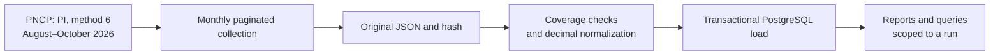

# AskTrace

[](https://github.com/luizznelson/asktrace/actions/workflows/quality.yml)

**Investigate public procurement with source data and a verifiable path to the answer.**

An applied AI engineering portfolio project developed by Luiz. The first delivery builds an auditable database of electronic procurement auctions in Piauí, Brazil. A bounded question router is implemented; the baseline is evaluated and explicit multi-provider contingency is implemented and evaluated with recorded limitations.

[Português](README.md) · [Case study](docs/case-study.md) · [Engineering decisions](docs/architecture.md) · [Documentation](docs/README.md)

## In one minute

| | |
| --- | --- |
| **Problem** | An answer about procurement can omit pages, treat unknown values as zero or mix periods and procurement methods. |
| **What I built** | A paginated PNCP collector, exact decimal normalization, transactional PostgreSQL loading and reports linking records to original pages. |
| **Verified result** | 1,081 auctions published August–October 2026, across 23 pages, checked in PostgreSQL. Missing awarded amounts in 749 records remain NULL. Contract acquisition covered all 1,080 eligible purchases: 125 contracts, with one purchase excluded due to an invalid year. [Coverage](docs/contract-coverage.md). |
| **Skills demonstrated** | Python 3.14, public API integration, data quality, SQL, PostgreSQL with Docker, provenance, failure testing and configured CI. |
| **Current stage** | Purchases, linked contracts and read-only business queries verified locally. Evaluated bounded routing with explicit provider contingency; a local PT-BR/EN interface, with no hosted demo yet. |
| **Start here** | [Method and results](docs/ingestion.md) · [Database verification](runs/pncp-3020d59b-d274-4f4c-be4f-d59e8be30101/database-load.json) · [Quality checks](docs/quality.md) |

## 1. The problem: a page is not a dataset

An initial PNCP sample contains 50 records but reports **454 results across 10 pages**. Treating that file as complete would omit most results. This sample is from October 2025, separate from the 2026 collection.

The proposed user investigates public procurement and needs to understand the period, method, coverage and source behind each value. Those limits must remain visible before interpreting an answer.

## 2. A database before the agent

**Bounded query → original pages → validation → normalization → PostgreSQL → verifiable report.**



Runs have unique identifiers and distinguish samples, failures and completed live collections. Snapshots are separate: loading or analyzing multiple snapshots must not count the same purchase twice.

## 3. What was verified

| Question | Evidence |
| --- | --- |
| Records received within scope? | **1,081**: 412 in August, 373 in September and 296 in October 2026; pagination totals matched. |
| Loaded into the database? | PostgreSQL contained the same 1,081 records. Loading again returned `already_loaded`. |
| Awarded amounts always available? | No. **749** records omit that field; missing values remain unknown. |
| All public procurement in Piauí? | No. Only method 6, PI administrative units and publication dates. Contracts and price-registration records are not included. |
| Has an AI agent been evaluated? | No. Ingestion and software tests do not measure an agent’s answer quality. |

Matching counts cannot prove the portal stayed unchanged during collection. An awarded amount is not a payment; its absence does not prove cancellation. Productivity and financial savings have not been measured.

[Method and limitations](docs/ingestion.md) · [Manifest](runs/pncp-3020d59b-d274-4f4c-be4f-d59e8be30101/manifest.json) · [Quality](runs/pncp-3020d59b-d274-4f4c-be4f-d59e8be30101/quality.json)

## 4. Engineering choices

| Decision | Why | Evidence |
| --- | --- | --- |
| Separate acquisition and loading | Reinspect the same bytes without another API request. | [Architecture](docs/architecture.md) |
| Recheck dates, state and method | Do not rely solely on request parameters. | [Collector and normalization](asktrace/ingest.py) |
| Decimal and NUMERIC | Avoid floating-point conversion and preserve missing values. | [SQL schema](sql/002_purchases.sql) |
| Transactions and run identity | Prevent partial loads and repeat-load duplication. | [Loader](asktrace/database.py), [database tests](tests/test_database_integration.py) |
| Explicit failure states | A timeout, interruption or page budget is not success. | [Ingestion tests](tests/test_ingestion.py) |

## 5. Check the work locally

Read the reports above without installing anything. To test the code, use Python 3.14 and uv from the project directory:

```powershell
uv venv --python 3.14
uv pip install --python .venv/Scripts/python.exe --require-hashes -r requirements.txt
uv pip install --python .venv/Scripts/python.exe -r requirements-dev.txt
.venv/Scripts/python.exe -m unittest discover -s tests -v
```

Do not recreate an already configured environment. Two PostgreSQL tests are explicitly skipped unless integration is enabled. See [ingestion](docs/ingestion.md) and [development](docs/development.md) for Docker setup and reproduction. On first use, configure a local password using `.env.example`; never commit `.env`. Commands above target Windows. Detailed guides currently use Portuguese.

## 6. Repository map

| Directory | Contents |
| --- | --- |
| `asktrace/` | Collection, normalization and verified loading. |
| `sql/` | Provenance ledger, normalized tables and a live-data view. |
| `tests/` | Pagination, failure, precision, integrity and transaction checks. |
| `amostras/` | Historical public samples; contracts include a masked derivative and provenance. |
| `runs/` | Published manifests and reports identifying each run’s mode and status. |
| `docs/` | Case study, decisions, evidence, commands and limitations. |

Full downloads stay local in ignored `data/raw/` and `data/processed/`. Hashes in reports do not make those files remotely available. [Documentation index](docs/README.md).

## Linked contracts: current coverage

Confirmed coverage: **1080 distinct purchases and 125 distinct contracts**;
0 eligible purchases remain. The original population contains 1081
purchases, including one excluded from contract acquisition due to an invalid source year.
There are 85 purchases with contracts and 995 with no
published records returned. This covers the selected purchase scope, not every contract in Piauí.
See [evidence and limitations (Portuguese)](docs/contract-coverage.md). The bounded router and its evaluation are described below.

## Available business questions

Fixed queries provide a coverage summary, municipality breakdown and purchase-level provenance. They use a separate read-only login and never accept arbitrary SQL. Real examples are published and all 51 local tests passed. [Commands and evidence (Portuguese)](docs/business-queries.md). The bounded router and its evaluation are described below.

## Text questions, contingency and evaluation

Contingency uses Qwen and GPT-OSS on Groq, free Xing on OpenRouter and Gemini when quota permits.
It attempts at most three planners and executes at most one business query. Shared quota is not
multiplied by rotating models on the same account; a valid refusal ends the request.

All 60 development cases passed across two compatible segments, plus eight additional questions.
The main corpus used 40 LLM plans and 20 local-policy refusals. GPT-OSS passed three live smoke
tests; OpenRouter passed two and returned 429 on the third. Backup models do not inherit the primary
model's score. All 79 local software tests passed, including PostgreSQL integration.
[Configuration and limits](docs/provider-contingency.md) · [Evaluation method](docs/agent-evaluation.md) (Portuguese).

## Local interface

The PT-BR/EN interface connects the project story, questions, answers, coverage, sources and trace.
Run `python -m asktrace.web` in the project environment and open `http://127.0.0.1:8010`.
Choose local rules or AI contingency; business questions are currently supported in Portuguese.
All six real HTTP flows passed, alongside 86 local software tests. Browser visual inspection remains
pending because browser preview is disabled in this environment. [Usage and limitations](docs/interface.md) (Portuguese).

## 7. Next steps and attribution

Next, review the interface visually on desktop/mobile and prepare hosting with access controls. Price-registration records still need a separate acquisition strategy. Read-only tools, exact calculations, semantic search and evaluated questions follow. UI, video and a hosted demo will be added when the real workflow exists. [Plan](PLANO.md).

Data comes from [PNCP](https://www.gov.br/pncp/pt-br) and its [official API](https://pncp.gov.br/api/consulta/swagger-ui/index.html). This project is independent of the portal. The [code license](LICENSE) does not determine third-party data licensing.

AI assisted development. The maintainer remains responsible for understanding, reviewing and verifying the result.
