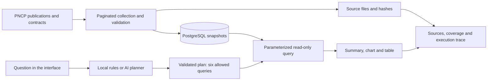

# AskTrace

**[Open live demo](https://asktrace-pyop.onrender.com)**

**Prepare a procurement analysis: compare publications, choose what to inspect and take the sources.**

[Português](README.md) · [Case study](docs/case-study.md) · [Architecture](docs/architecture.md) · [Documentation](docs/README.md)


[](https://github.com/luizznelson/asktrace/actions/workflows/quality.yml)

**Video walkthrough (62 s):** [English](docs/assets/demo/asktrace-demo-en.mp4) · [Português](docs/assets/demo/asktrace-demo.mp4). Real captures of the published app in an edited sequence; the video does not measure response time. To rebuild it: `python scripts/build_demo.py --language en` (or `pt`), using the captures and storyboard in `docs/assets/demo/source/` and `docs/media/storyboard.json`.

AskTrace supports the preparation of public procurement monitoring reports. The analyst
needs to understand the overview, choose what to inspect more closely and explain which
data supports the findings. The application combines publication comparisons, lookup of
an identified purchase and exports with sources, using a historical dataset from
Brazil's National Public Procurement Portal (PNCP).

## In one minute

| | |
| --- | --- |
| **Problem** | A procurement report can treat a publication as a payment or a blank field as zero. Numbers must be traceable to their origin. |
| **Core decision** | The LLM only picks one of six allowed queries. Numbers come from parameterized, read-only SQL, and database rows are never sent to the model. A rule-based mode, with no external API, serves the same six paths. |
| **Measured result** | Routing passed **60/60** curated cases, including refusals; AI fallback passed 60 of 61 runs. On Render, rule-based queries dropped from **20–23 s to 0.56–0.94 s** after moving evidence verification to startup (two observed runs). |
| **Next open decision** | Measure with users whether natural-language questions add value over the rule-based mode. |
| **Where to check** | [Architecture decisions](#architecture-decisions-and-trade-offs), [full architecture](docs/architecture.md) and [quality](docs/quality.md). |

## Choose a reading path

- **Understand the purpose:** scenario, questions and example below, then the [case study](docs/case-study.md).
- **Review the engineering:** [architecture decisions](#architecture-decisions-and-trade-offs), [architecture](docs/architecture.md) and [quality](docs/quality.md).
- **Run or reproduce:** [instructions in this README](#run-and-reproduce) and [environment and dataset preparation](docs/development.md).

## A scenario that explains the purpose

**Illustrative scenario:** a team wants an overview of purchases published during a
selected period. The report's author needs to explain where publications are concentrated,
how they vary across months and what information requires checking.

The task involves more than presenting a total. Records need comparison, unknown fields
need to stay distinct from known values, and the numbers need an inspectable origin.
Otherwise, a report could treat publication as payment or present an unknown amount as
zero. These are interpretation risks explicitly handled by the project, without claiming
how frequently they occur in organizations that have not been studied.

AskTrace organizes this task into a journey: **ask, compare, check and take the result
into the report**. The user receives a summary, visualizations when applicable, a table
and contextual exports. Analysis and the choice of what warrants a closer look remain
human decisions.

## What each audience receives

| Audience | What they need to understand | What the project delivers |
| --- | --- | --- |
| Management | What the overview establishes and where to look more closely | Publication comparisons, context and interpretation limits |
| Analysts | How to verify and use the numbers in a report | Tables, identifiers, sources and CSV/JSON exports |
| Engineers | How the system maintains consistent results | Controlled queries, collection evidence and documented tests |

The intended benefit is to support an explainable, verifiable analysis. **User validation
and measurements of time, cost or error reduction have not yet taken place.** The audience
is proposed, not an existing customer base.
[PNCP already provides search and dashboards](https://www.gov.br/pncp/pt-br/pncp); AskTrace
offers an additional way to explore the dataset through questions. See the
[business rationale](docs/business-case.md) (Portuguese) for hypotheses and a validation plan.

## From a question to an analysis decision

| Reporting need | Supported question | How to use the result |
| --- | --- | --- |
| Choose where to look more closely | Which organizations or municipalities have more purchases? | Compare publication volumes; rankings contain up to 20 groups |
| Describe the period | How do purchases vary by publication month? | Present the monthly series without treating publication as payment |
| Inspect an identified purchase | Trace a purchase by its PNCP ID | Examine linked contracts and provenance; an explicit ID is required |
| Explain the report's limitations | How complete are the fields? | Show unknown fields and coverage without replacing missing values with zero |

**Journey:** check scope → compare publications → look up a purchase by ID → verify
sources → export CSV/JSON. Queries are independent: rankings do not open a filtered list
of an organization's purchases. The user selects the record to inspect.

## The role of AI

AI interprets a Portuguese question and selects one of six allowed queries. The database
provides calculations and numerical answers. A local rules mode supports the same catalog
without an external API. The added value of natural language still needs a user-task
comparison with that mode. This is not a RAG system. The interface supports Portuguese and
English; questions are supported in Portuguese. The application currently runs locally.

## Try an investigation

| Ask in Portuguese | What you receive | How to verify |
| --- | --- | --- |
| Como evoluíram as compras por mês de publicação? | Calculated summary, six-month chart and table | June has 527 publications; the series totals 2,537 purchases |
| Quais órgãos têm mais compras na base? | Up to 20 purchasing organizations, with a first-five preview | Organization CNPJ, estimates and missing-value counts |
| Rastreie a compra 00394452000103-1-011584/2026. | Purchase details and linked contracts | Identifiers, source indexes and page hashes |

Coverage overview, municipalities and data completeness are also available. Summaries
and charts use the returned rows without a second AI call. JSON and CSV preserve scope
and original values.

## Verified deliverables: data coverage

| Default scope: May–October 2026 publications, method 6, units in Piauí | Count |
| --- | ---: |
| Purchases in the dataset | 2,537 |
| Eligible purchases searched for contracts | 2,536 |
| Contracts linked to 370 purchases | 679 |
| Searched purchases returning no contract publication | 2,166 |
| Eligible searches pending | 0 |
| Invalid-source-year exclusion | 1 |

These are snapshot counts, not financial impact metrics. Publication does not establish
payment; no returned publication does not establish absence of a contract. The 1,354
unreported awarded amounts remain unknown. The original August–October snapshot stays
separate and is never added to the default dataset.

[Coverage and database verification](docs/contracts-expanded-coverage.md) · [Interpretation limits](docs/analytics.md) (Portuguese)

## How it works



The model selects a reviewed query; it does not write SQL or generate the numerical
answer. Database results are not sent to the planner. Local rules support the same six
paths without an external API. Tab history is not model conversation memory and marks
results from earlier dataset versions.

## Architecture decisions and trade-offs

Each row summarizes a choice recorded in the ADRs in [docs/architecture.md](docs/architecture.md), with the discarded alternative and the accepted cost.

| Decision | Why (and what was discarded) | Accepted cost | Evidence |
| --- | --- | --- | --- |
| **Build the auditable dataset before the agent** | Separating collection, normalization and loading allows reloading the same bytes; writing API responses straight to the database was discarded | More files and a hash manifest to maintain | [ADR-001](docs/architecture.md), [ingestion](docs/ingestion.md) |
| **One snapshot per run, no in-place updates by ID** | Do not hide changes between collections | More history; every query must pick a run to avoid double counting | [database.py](asktrace/database.py) |
| **Decimal, NUMERIC and NULL** | Floats or blanks-as-zero would change what values mean | Harder arithmetic; 1,354 awarded values stay unknown | [Queries](asktrace/query.py) |
| **Single-transaction load** | A partial load could look like a finished dataset | A failure requires reloading | [database.py](asktrace/database.py) |
| **LLM picks from a catalog; it neither writes SQL nor sees the data** | Limit wrong answers and database access | Only six question types are served; the rest is refused | [Agent](asktrace/agent.py), [permissions](sql/004_reporting.sql) |
| **Verify evidence at startup, not on every question** | The first version reread thousands of files per query (20–23 s) | Slower startup and more memory; updating the data requires a restart | [ADR-002](docs/architecture.md), [measurement](runs/render-performance-59ca88d-verified/verification.json) |
| **Fallback across LLM providers with bounded retries** | The service does not depend on a single provider | Answers may vary with the provider used | [Fallback](docs/provider-contingency.md) |
| **Separate read and state logins; admin loading outside the server** | The public app never gets the credential that changes the data | More credentials to operate | [Deployment](docs/deployment.md) |

Tests prove bounded behaviors; usefulness with real users still needs validation. AI assistance during development is declared at the end of this README.

## Software checks and AI evaluation are different

- **Software:** 137 Python tests in the latest suite, including isolated PostgreSQL;
  Node contracts cover UI, charts, formatting and CSV. [Verification](docs/quality.md).
- **Local v3 routing:** 60/60 author-curated release cases covering six queries and refusals.
- **AI contingency v3:** 60 passes across 61 executions, with one failure preserved.
  All 60 cases completed after explicitly retrying the failed case.
  [Method and limitations](docs/agent-evaluation.md#avaliação-final-do-catálogo-v3) (Portuguese).
- **Data restoration and public routes:** no recollection; 12 actual ASGI queries using
  local PostgreSQL. [Final verification](runs/release-readiness-411e550a-cfc1-4cd5-bac5-a73e3ba2cf33/verification.json).
- **Deployment:** all six queries for both datasets passed over public HTTPS, along
  with refusal, session protection and one real AI query. [Render evidence](runs/render-verification-5c4ad84a-6be1-46af-a81b-5965ccc471f6/verification.json).
- **Interface:** the landing page, PT-BR/EN toggle, query, tab history and CSV download
  were checked in the hosted browser. Full visual review and video remain pending.

Curated cases do not establish general model accuracy or measured business savings.

## Run and reproduce

Test the code with local fixtures without downloading PNCP again:

```powershell
uv venv --python 3.14
uv pip install --python .venv/Scripts/python.exe --require-hashes -r requirements.txt
uv pip install --python .venv/Scripts/python.exe -r requirements-dev.txt
.venv/Scripts/python.exe -m unittest discover -s tests -q
node tests/test_display_formatters.cjs
node tests/test_result_presentation.cjs
node tests/test_assistant_ui.cjs
```

Python 3.14 is required; CI uses Node 22. Database tests need PostgreSQL and explicit
opt-in. CI is configured; the badge above reflects its remote execution.

**Running the real-data app requires additional preparation:** PostgreSQL, verified
raw/processed downloads and loaded snapshots. Downloads are not included in Git.
Published hashes do not replace these files, and a fresh collection may return different
bytes. Follow [development](docs/development.md), [ingestion](docs/ingestion.md) and
[contracts](docs/contracts-expanded-coverage.md) (Portuguese). AI keys are optional for
local-rule mode. Secrets belong in ignored `.env`, never tracked `.env.example`.

Once prepared, run `.venv/Scripts/python.exe -m asktrace.web` and open
`http://127.0.0.1:8010` for the local preview.

**Live application:** [Render Free](https://asktrace-pyop.onrender.com) with Neon PostgreSQL, separate
credentials, evidence restoration and persistent limits. Public HTTPS was verified
on November 5, 2026. See the [deployment guide](docs/deployment.md) (Portuguese).

**Observed Render performance:** the six local-rule queries on the larger dataset
took 0.563–0.940 seconds after optimization, compared with 20–23 seconds before.
One AI query took 1.884 seconds. These are two observed runs, not a performance
guarantee. [Evidence and comparison](runs/render-performance-59ca88d-verified/verification.json).

The Neon database was loaded and verified: six routes for each dataset passed with
restricted logins, evidence was restored from the database, and the budget survived
restarting the test application. [Remote verification](runs/neon-verification-187bed11-8da5-4be2-8712-d694a4ea11a0/verification.json).
The separate public HTTPS check is recorded in the [Render evidence](runs/render-verification-5c4ad84a-6be1-46af-a81b-5965ccc471f6/verification.json).

**Optimization deployed and checked:** commit `59ca88d`, twelve queries across both datasets,
one real AI request, a fresh instance retaining the usage budget, and rejection of the
previous instance's token. [Public verification](runs/render-performance-59ca88d-verified/verification.json). Wake-up after idle suspension
is a separate check and remains unverified.

## Explore further

[Case study](docs/case-study.md) · [Architecture](docs/architecture.md) · [Analyses](docs/analytics.md) ·
[Evidence index](runs/README.md) · [Plan](PLANO.md) (Portuguese)

Construction history remains in documentation and `runs/`; this README describes the
current product. Source: [PNCP](https://www.gov.br/pncp/pt-br). The [code license](LICENSE)
does not determine third-party data licensing. AI assisted development; understanding,
review and verification remain the maintainer's responsibility.
