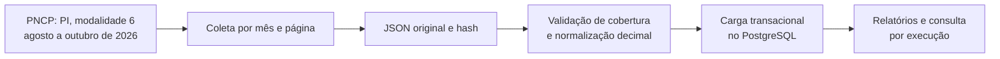

# AskTrace

[](https://github.com/luizznelson/asktrace/actions/workflows/quality.yml)

**Investigar compras públicas com dados de origem e um caminho verificável até a resposta.**

Projeto de portfólio de engenharia de IA aplicada, desenvolvido por Luiz. A primeira entrega constrói a base auditável de pregões eletrônicos do Piauí. Um roteador limitado de perguntas está implementado; o baseline foi avaliado e há contingência explícita entre provedores, com avaliações e limites registrados.

[English](README.en.md) · [Estudo de caso](docs/case-study.md) · [Decisões de engenharia](docs/architecture.md) · [Documentação](docs/README.md)

## Em 1 minuto

| | |
| --- | --- |
| **Problema** | Uma resposta sobre compras públicas pode ignorar páginas, tratar um valor ausente como zero ou misturar períodos e modalidades. |
| **O que construí** | Coletor paginado do PNCP, normalização com precisão decimal, carga transacional no PostgreSQL e relatórios que ligam cada registro à página original. |
| **Resultado verificado** | 1.081 pregões publicados de agosto a outubro de 2026, em 23 páginas, conferidos no banco. São 749 registros sem valor homologado informado, mantidos como NULL. Consulta de contratos concluída para 1.080 compras elegíveis: 125 contratos; uma compra excluída por ano inválido. [Cobertura](docs/contract-coverage.md). |
| **Habilidades demonstradas** | Python 3.14, integração com API pública, qualidade de dados, SQL, PostgreSQL com Docker, rastreabilidade, testes de falhas e CI configurada. |
| **Estágio atual** | Compras, contratos vinculados e consultas de negócio somente leitura verificados localmente. Roteador com contingência e avaliação local; sem interface ou demonstração online. |
| **Onde começar** | [Resultado e método](docs/ingestion.md) · [Evidência no banco](runs/pncp-3020d59b-d274-4f4c-be4f-d59e8be30101/database-load.json) · [Como verificar](docs/quality.md) |

## 1. O problema: contar registros não basta

Uma amostra do PNCP contém 50 registros, mas informa **454 resultados em 10 páginas**. Tomar apenas o arquivo recebido como a base completa eliminaria a maior parte daquela consulta. Essa amostra é de outubro de 2025 e não faz parte dos números da coleta de 2026.

O cenário proposto é alguém investigando compras públicas: precisa conhecer o período, a modalidade, a cobertura e a origem de cada valor antes de interpretar uma resposta. A documentação e o código precisam tornar esses limites visíveis.

## 2. A solução atual: uma base antes do agente

**Consulta delimitada → páginas originais → validação → normalização → PostgreSQL → relatório verificável.**



Cada execução recebe um identificador. Amostra, falha e coleta real concluída têm estados diferentes. Os snapshots ficam separados, permitindo conferir uma execução sem somar a mesma compra novamente em outra coleta.

## 3. O que os dados permitem afirmar

| Pergunta | Evidência disponível |
| --- | --- |
| Quantos pregões foram recebidos no recorte? | **1.081**, com totais de paginação conferidos: 412 em agosto, 373 em setembro e 296 em outubro de 2026. |
| Foram carregados no banco? | Sim. A conferência PostgreSQL encontrou os mesmos 1.081 registros. Uma segunda carga retornou `already_loaded`. |
| Todos informam valor homologado? | Não. **749** não informam esse campo; ausência não virou zero. |
| É toda a contratação pública do Piauí? | Não. O recorte é modalidade 6, UF da unidade igual a PI e data de publicação. Não inclui contratos e atas. |
| Já há respostas de IA avaliadas? | Não. Coleta e testes de software não medem qualidade de respostas de um agente. |

Igualdade entre contagens não prova que o portal permaneceu inalterado durante a coleta. Valor homologado não é valor pago; sua ausência não comprova cancelamento. Ganhos de produtividade ou economia ainda não foram medidos.

[Método, limites e reprodução](docs/ingestion.md) · [Manifesto da coleta](runs/pncp-3020d59b-d274-4f4c-be4f-d59e8be30101/manifest.json) · [Qualidade](runs/pncp-3020d59b-d274-4f4c-be4f-d59e8be30101/quality.json)

## 4. O que a implementação demonstra

| Decisão | Por que foi feita | Onde conferir |
| --- | --- | --- |
| Separar aquisição e carga | Reexaminar os mesmos bytes sem depender de uma nova resposta da API. | [Arquitetura](docs/architecture.md) |
| Verificar datas, UF e modalidade | Não confiar somente no filtro enviado ao servidor. | `normalize` em [ingest.py](asktrace/ingest.py) |
| Usar Decimal e NUMERIC | Preservar valores sem passar por float; ausências continuam desconhecidas. | [Ingestão](docs/ingestion.md), [esquema SQL](sql/002_purchases.sql) |
| Usar transação e identidade da execução | Evitar carga parcial e duplicação ao carregar novamente o mesmo manifesto. | [database.py](asktrace/database.py), [testes PostgreSQL](tests/test_database_integration.py) |
| Manter estados de falha explícitos | Não apresentar timeout, interrupção ou download limitado como sucesso. | [Testes da ingestão](tests/test_ingestion.py) |

## 5. Como conferir sem baixar os dados novamente

Comece pelos relatórios vinculados acima. Para testar o código, use Python 3.14 e uv, na pasta do projeto:

```powershell
uv venv --python 3.14
uv pip install --python .venv/Scripts/python.exe --require-hashes -r requirements.txt
uv pip install --python .venv/Scripts/python.exe -r requirements-dev.txt
.venv/Scripts/python.exe -m unittest discover -s tests -v
```

Se `.venv` já existir e estiver configurado, não é necessário recriá-lo. Sem a opção de integração, dois testes PostgreSQL são ignorados explicitamente. Para executá-los, iniciar o banco e reproduzir a coleta, siga o [guia de ingestão](docs/ingestion.md) e o [guia de desenvolvimento](docs/development.md). No primeiro uso, configure a senha local a partir de `.env.example`; nunca versione `.env`.

## 6. Como investigar o repositório

| Pasta | O que mostra |
| --- | --- |
| `asktrace/` | Coleta, normalização e carga verificável. |
| `sql/` | Registro de origem, tabelas normalizadas e visão que separa amostras de dados reais. |
| `tests/` | Paginação, falhas, precisão, integridade e transações PostgreSQL. |
| `amostras/` | Páginas históricas públicas para exploração; contratos têm cópia mascarada com proveniência. |
| `runs/` | Manifestos e relatórios publicados, com modo e estado de cada execução. |
| `docs/` | Caso de uso, decisões, evidências, comandos e limitações. |

Os downloads completos ficam localmente em `data/raw/` e `data/processed/`, excluídos do Git. Os relatórios registram os hashes, mas não disponibilizam esses arquivos por si só. [Índice de documentação](docs/README.md).

## Contratos vinculados: cobertura atual

**Cobertura elegível concluída:** 1.080 compras distintas confirmadas. 125 contratos distintos e 0 compras elegíveis pendentes.
A população original tem 1081 compras; uma ficou excluída por ano inválido na fonte.
São 85 compras com contratos e 995 sem publicação retornada.
Isso descreve o recorte de pregões selecionado, não todos os contratos do Piauí.
Veja [método, evidências e limites](docs/contract-coverage.md). O roteador limitado e sua avaliação estão descritos abaixo.

## Perguntas de negócio disponíveis

Consultas fixas respondem o resumo da cobertura, a distribuição por município e o rastreio de uma compra. Usam credencial separada somente leitura, sem receber SQL livre. Há exemplos reais e 51 testes locais aprovados. [Como consultar e verificar](docs/business-queries.md). Roteamento em texto e avaliação estão descritos a seguir.

## Perguntas em texto, contingência e avaliação

O modo de contingência usa Qwen e GPT-OSS pela Groq, Xing gratuito pelo OpenRouter e Gemini
quando sua quota permitir. Pode tentar até três planejadores e executar uma única consulta de negócio.
Quota compartilhada não é multiplicada trocando modelos da mesma conta; recusas válidas encerram o fluxo.

Foram aprovados os 60 casos de desenvolvimento em dois trechos compatíveis e oito perguntas
adicionais. No corpus principal foram 40 planos LLM e 20 recusas locais. O GPT-OSS passou em três
testes reais; o OpenRouter passou em dois e encontrou 429 no terceiro. Os modelos de reserva não
herdam a nota do principal. O código atual passou em 79 testes locais, incluindo PostgreSQL.
[Modelos, configuração e limites](docs/provider-contingency.md) · [Método de avaliação](docs/agent-evaluation.md).

## 7. O que vem depois

O próximo passo é construir a interface com recorte, resposta, fonte e rastro, e medir perguntas externas separadamente. Atas ainda precisam de estratégia própria. Depois entram ferramentas somente leitura, cálculo exato, busca semântica e avaliação de perguntas. Interface, vídeo e demonstração serão acrescentados quando houver fluxo real para mostrar. [Plano](PLANO.md).

Fonte dos dados: [PNCP](https://www.gov.br/pncp/pt-br) e sua [API oficial](https://pncp.gov.br/api/consulta/swagger-ui/index.html). O projeto é independente do portal. Consulte a [licença do código](LICENSE); ela não determina a licença dos dados de terceiros.

Houve assistência de IA no desenvolvimento. A responsabilidade por compreender, revisar e verificar as entregas é do mantenedor.
