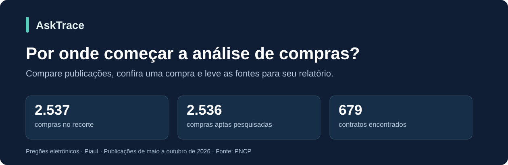
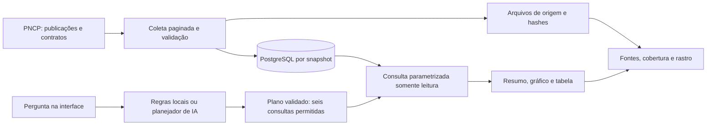

# AskTrace

**Prepare uma análise de compras públicas: compare publicações, escolha o que conferir e leve as fontes.**

[English](README.en.md) · [Estudo de caso](docs/case-study.md) · [Arquitetura](docs/architecture.md) · [Documentação](docs/README.md)



[](https://github.com/luizznelson/asktrace/actions/workflows/quality.yml)

O AskTrace apoia a preparação de relatórios de acompanhamento de compras públicas.
A pessoa que faz essa análise precisa entender o panorama, escolher o que conferir com
mais detalhe e explicar quais dados sustentam suas conclusões. O aplicativo reúne
comparações de publicações, consulta de uma compra identificada e exportação com fontes,
usando um recorte histórico do Portal Nacional de Contratações Públicas (PNCP).

## Uma situação que explica a proposta

**Cenário ilustrativo:** uma equipe quer um panorama das compras publicadas no período.
O responsável pelo relatório precisa responder: onde as publicações se concentram,
como se distribuem ao longo dos meses e quais informações precisam de conferência?

A tarefa envolve mais do que mostrar um total. É preciso comparar os registros, separar
informações conhecidas das ausentes e manter a origem dos números disponível. Sem essas
distinções, o relatório pode tratar uma publicação como pagamento ou apresentar um campo
desconhecido como zero. São riscos de interpretação que o projeto trata explicitamente,
sem atribuir sua frequência a organizações que não foram estudadas.

O AskTrace organiza essa tarefa em um percurso: **perguntar, comparar, conferir e levar
o resultado para o relatório**. O usuário recebe um resumo, visualizações quando cabíveis,
uma tabela e arquivos de exportação com contexto. A análise e a escolha do que merece
aprofundamento continuam com a pessoa.

## O valor da entrega para cada público

| Quem lê ou usa | O que precisa entender | O que o projeto entrega |
| --- | --- | --- |
| Gestão | O que o panorama permite dizer e onde aprofundar a leitura | Comparações de publicações, contexto e limites da conclusão |
| Análise | Como conferir e incorporar os números no relatório | Tabelas, identificadores, fontes e exportação CSV/JSON |
| Engenharia | Como o sistema mantém os resultados consistentes | Consultas controladas, evidências da coleta e testes documentados |

O benefício pretendido é apoiar uma análise explicável e conferível. **Não houve ainda
validação com usuários ou medição de economia de tempo, custo ou redução de erros.**
O público descrito é proposto, não uma carteira de clientes. O
[PNCP já oferece busca e painéis](https://www.gov.br/pncp/pt-br/pncp); o AskTrace apresenta
uma forma adicional de explorar o recorte por perguntas. As hipóteses e o plano de
validação estão na [visão de negócio](docs/business-case.md).

## Da pergunta à decisão de análise

| Necessidade do relatório | Pergunta atendida | Como usar o resultado |
| --- | --- | --- |
| Escolher onde aprofundar a leitura | Quais órgãos ou municípios têm mais compras? | Comparar volumes de publicações; o ranking é limitado a 20 grupos |
| Descrever a distribuição no período | Como evoluíram as compras por mês de publicação? | Apresentar a série mensal, sem confundir publicação com pagamento |
| Conferir uma compra já identificada | Rastreie a compra pelo ID PNCP | Examinar contratos vinculados e sua origem; exige informar o ID |
| Explicitar limites do relatório | Como está o preenchimento dos dados? | Mostrar campos desconhecidos e cobertura, sem convertê-los em zero |

**Percurso:** conferir o recorte → comparar publicações → consultar uma compra pelo ID
→ conferir fontes → exportar CSV/JSON. As consultas são independentes: o ranking não
abre uma lista filtrada de compras por órgão. O usuário escolhe o registro a conferir.

## Onde entra a IA

A IA interpreta uma pergunta em português e escolhe entre seis consultas permitidas.
Os cálculos e as respostas numéricas vêm do banco. Existe um modo por regras locais,
sem API externa, para o mesmo catálogo. O valor adicional da linguagem natural ainda
precisa ser comparado com esse modo em tarefas com usuários. Não é um sistema RAG.
Interface em PT-BR e inglês; perguntas suportadas em português. Execução atual local.

## Experimente uma investigação

| Pergunte | O que você recebe | Como conferir |
| --- | --- | --- |
| Como evoluíram as compras por mês de publicação? | Resumo calculado, seis meses em gráfico e tabela | Junho tem 527 publicações; a série soma 2.537 compras |
| Quais órgãos têm mais compras na base? | Até 20 órgãos por quantidade, com prévia dos cinco primeiros | CNPJ do órgão, valores estimados e campos ausentes |
| Rastreie a compra 00394452000103-1-011584/2026. | Dados da compra e contratos vinculados | Identificadores, índices e hashes das páginas de origem |

Também estão disponíveis panorama da cobertura, municípios e qualidade dos dados.
Os resumos e gráficos são calculados a partir das linhas retornadas, sem uma segunda
chamada de IA. JSON e CSV preservam contexto e valores originais.

## Entregas verificadas: cobertura dos dados

| Base padrão: publicações de maio–outubro/2026, modalidade 6, unidades do Piauí | Quantidade |
| --- | ---: |
| Compras na base | 2.537 |
| Compras aptas com contratos pesquisados | 2.536 |
| Contratos vinculados a 370 compras | 679 |
| Compras pesquisadas sem publicação retornada | 2.166 |
| Compras aptas pendentes | 0 |
| Exclusão por ano inválido na fonte | 1 |

São contagens deste snapshot, não indicadores de impacto financeiro. Publicação não
comprova pagamento; ausência no portal não comprova ausência de contrato. Os 1.354 valores
homologados não informados permanecem desconhecidos. O recorte original de agosto–outubro
é separado e nunca é somado à base padrão.

[Conferência da cobertura e do banco](docs/contracts-expanded-coverage.md) · [O que as análises permitem concluir](docs/analytics.md)

## Como funciona



O modelo escolhe uma consulta do catálogo; não escreve SQL nem inventa o resultado
numérico. Os dados do banco não são enviados ao planejador. Sem API externa, o modo por
regras atende os mesmos seis caminhos. O histórico organiza a aba, sem memória
conversacional no modelo, e identifica respostas de versões anteriores da base.

## Decisões de engenharia que você pode verificar

| Decisão | Problema evitado | Evidência |
| --- | --- | --- |
| Decimal → NUMERIC → texto decimal | Perda de precisão e ausência convertida em zero | [Consultas](asktrace/query.py), [formatação](web/formatters.js) |
| Hashes, snapshots e carga idempotente | Alteração silenciosa de fontes e duplicação na carga | [Integridade](asktrace/evidence.py), [cobertura concluída](docs/contracts-expanded-coverage.md) |
| Plano validado e login de leitura | SQL livre gerado pelo modelo e escrita no banco | [Agente](asktrace/agent.py), [permissões](sql/004_reporting.sql) |
| Tentativas limitadas e espera por provedor | Rotação de modelos para contornar quota e falhas ocultas | [Contingência](docs/provider-contingency.md) |
| Conteúdo e escopo no CSV | Exportação sem origem e fórmulas de planilha em texto externo | [Exportação](docs/analytics.md) |

## Qualidade: software e IA são verificações diferentes

- **Software:** 112 testes Python na última suíte, com PostgreSQL isolado; contratos Node
  para interface, gráficos, formatação e CSV. [Como reproduzir e interpretar](docs/quality.md).
- **Roteamento local v3:** 12/12 casos curados do catálogo ampliado, incluindo recusas.
- **IA v3:** três testes iniciais reais, um por nova análise. A avaliação ampla do
  planejador v3 ainda está pendente. Os resultados do prompt anterior são históricos.
- **Interface:** verificações DOM e HTTP realizadas. A inspeção visual em navegador e
  o vídeo de demonstração não estão concluídos; não há demo pública hospedada.

Não há promessa de acurácia geral baseada nos testes curados, nem economia de trabalho medida.

## Executar e reproduzir

Para testar o código com fixtures locais, sem baixar novamente o PNCP:

```powershell
uv venv --python 3.14
uv pip install --python .venv/Scripts/python.exe --require-hashes -r requirements.txt
uv pip install --python .venv/Scripts/python.exe -r requirements-dev.txt
.venv/Scripts/python.exe -m unittest discover -s tests -q
node tests/test_display_formatters.cjs
node tests/test_result_presentation.cjs
node tests/test_assistant_ui.cjs
```

O código usa Python 3.14; os testes JavaScript usam Node 22 na CI. Testes de banco exigem
PostgreSQL e opt-in explícito. A CI está configurada; o badge acima reflete a execução remota.

**Rodar o app com a base real exige preparação adicional:** PostgreSQL, downloads
brutos/processados verificados e carga dos snapshots. Esses downloads não estão no Git.
Os hashes publicados não substituem os arquivos e uma nova coleta pode retornar bytes
diferentes. Siga [desenvolvimento](docs/development.md), [ingestão](docs/ingestion.md) e
[contratos](docs/contracts-expanded-coverage.md). A chave de IA é opcional no modo local;
segredos ficam no `.env` ignorado, nunca no `.env.example` versionado.

Com a base preparada, execute `.venv/Scripts/python.exe -m asktrace.web` e abra
`http://127.0.0.1:8010`. O servidor atual é local; não é um serviço multiusuário pronto
para exposição pública.

## Para aprofundar

[Caso de uso e percurso](docs/case-study.md) · [Arquitetura e decisões](docs/architecture.md) ·
[Análises e exportação](docs/analytics.md) · [Índice de evidências](runs/README.md) · [Plano](PLANO.md)

O histórico da construção permanece na documentação e em `runs/`; o README descreve o
estado atual. Fonte: [PNCP](https://www.gov.br/pncp/pt-br). [Licença do código](LICENSE):
não determina a licença dos dados de terceiros. Houve assistência de IA no desenvolvimento;
a responsabilidade por compreender, revisar e verificar o código é do mantenedor.
