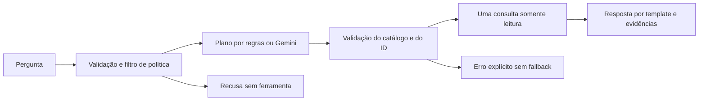

# Perguntas, roteamento e avaliação

## Problema resolvido

Uma pergunta em texto precisa selecionar a consulta correta, respeitar o recorte e preservar a origem
dos números. Dar liberdade para gerar SQL ou inferir pagamentos e economia não ajuda esse objetivo.
Esta entrega acrescenta um **roteador de uma etapa**, com dois modos explícitos:

| Modo | Seleção da ferramenta | Estado validado |
| --- | --- | --- |
| `baseline` | Regras locais determinísticas | 60 de 60 casos de desenvolvimento passaram com consultas reais |
| `gemini` | Modelo propõe plano JSON validado | Integração 3/3; avaliação completa iniciada e interrompida por HTTP 429 |

Não é um agente autônomo com pesquisa, memória ou várias iterações. O modo baseline não usa LLM.
O teste inicial com Gemini foi executado com a chave configurada localmente. O resultado abaixo
é separado do baseline e dos testes com mocks do provedor.

## Fluxo e limites



Há no máximo uma tentativa de LLM e uma chamada de ferramenta por pergunta. O planejador só pode
escolher `summary`, `municipalities`, `purchase` ou `refuse`. Não recebe conexão com o banco,
registros de compras, valores, SQL ou ferramentas de escrita. Um ID deve estar literalmente presente
na pergunta; o modelo não pode inventá-lo. Campos extras, planos incompletos ou fora do catálogo falham.

O template final usa os números retornados pelas consultas verificadas. O modelo não redige valores
ou conclusões. A resposta mostra UF, modalidade, período de publicação, cobertura, fontes e limites.
O texto livre do objeto da compra não é enviado ao modelo e é omitido da evidência do agente.
Isso reduz a superfície de instruções maliciosas em documentos; não prova resistência universal a ataques.

O filtro de política recusa alguns termos de pagamentos, fraude, economia, dados de fornecedor,
segredos e alterações antes do planejador. É um filtro conservador por termos, sujeito a falsos positivos
e lacunas semânticas, não um classificador completo. O baseline também pode selecionar uma tabela
genérica quando a pergunta pede filtros não suportados. O recorte explícito e o catálogo de ferramentas
continuam obrigatórios. Perguntas fora da amostra exigem revisão, não promessa de acerto.

## Executar sem API

```powershell
.venv/Scripts/python.exe -m asktrace.agent "Qual é o resumo da cobertura?" --coverage runs/contracts-resume-c1345679-59ea-49ad-af35-be2cc924ceab/coverage.json
.venv/Scripts/python.exe -m asktrace.agent "Quais municípios têm mais compras?" --coverage runs/contracts-resume-c1345679-59ea-49ad-af35-be2cc924ceab/coverage.json
.venv/Scripts/python.exe -m asktrace.agent "Qual foi a economia obtida?" --coverage runs/contracts-resume-c1345679-59ea-49ad-af35-be2cc924ceab/coverage.json
```

As respostas incluem `status`, texto, evidências, rastro, tentativas e latência. As recusas não chamam
o banco. Erros de provedor ou validação retornam `error`, sem expor mensagens, senhas ou payloads.
Não há fallback silencioso do Gemini para regras. `llm_attempts` é tentativa de usar o planejador LLM,
inclusive se faltar configuração, não uma contagem de chamadas faturadas pelo provedor.

## Configurar Gemini em arquivo

Adicione ao `.env` local, sem apagar as configurações do banco:

```dotenv
GEMINI_API_KEY=cole_sua_chave_localmente
GEMINI_MODEL=gemini-2.5-flash
```

O `.env.example` mostra somente os nomes e valores de exemplo. Nunca commitar `.env` ou a chave.
O modelo é configurável; sua disponibilidade e quota precisam ser confirmadas com uma chamada real.
O adaptador usa HTTPS, chave em cabeçalho, timeout de 30 segundos, limite de resposta e saída
estruturada. Não repete pedidos automaticamente para evitar multiplicar consumo. O status HTTP de
erro, quando disponível, aparece no rastro, sem o corpo da resposta do provedor.
Somente a pergunta e o catálogo de intenção são enviados ao Gemini; a resposta do banco não é enviada.

```powershell
.venv/Scripts/python.exe -m asktrace.agent "Qual é o resumo da cobertura?" --provider gemini --coverage runs/contracts-resume-c1345679-59ea-49ad-af35-be2cc924ceab/coverage.json
```

Referência do formato: [saída estruturada da API Gemini](https://ai.google.dev/gemini-api/docs/generate-content/structured-output).
O uso real depende da conta, quota e modelo; não afirmamos que o custo será zero.

## Avaliação reproduzível

O [corpus v1](../evals/business-v1.json) tem 60 perguntas: 20 de resumo, 12 de municípios,
oito de rastreio de uma compra e 20 recusas. Os valores esperados são explícitos e vinculados ao
snapshot de 1.081 compras. Os casos são de desenvolvimento, elaborados para este catálogo;
não constituem um teste cego, uma amostra de usuários ou uma comparação geral entre modelos.
As recusas do corpus são barradas pelo filtro antes do LLM, portanto não medem recusa do modelo.

```powershell
.venv/Scripts/python.exe -m asktrace.evaluate --coverage runs/contracts-resume-c1345679-59ea-49ad-af35-be2cc924ceab/coverage.json
.venv/Scripts/python.exe -m asktrace.evaluate --provider gemini --limit 3 --coverage runs/contracts-resume-c1345679-59ea-49ad-af35-be2cc924ceab/coverage.json
```

O segundo comando é um teste inicial pequeno: as três primeiras perguntas representam resumo,
municípios e rastreio. Executar a suíte completa com Gemini exige remover `--limit 3`.
O avaliador para no primeiro erro de provedor, registra a falha e retorna código diferente de zero.
Não troca de modelo e não apresenta perguntas não executadas como aprovadas.

A aprovação exige a ação e o status esperados, os valores globais de cobertura previstos e,
no rastreio, o ID esperado. Isso não valida toda frase possível, toda agregação municipal nem
respostas abertas. A correção das consultas tem testes de software próprios.
O relatório guarda cada caso, resultado, rastro, hash do corpus, relatório de cobertura e código.
Há cache local das consultas verificadas na avaliação, sem cache do plano Gemini. Por isso a latência
medida não é latência de produção sem cache. Tokens e modelo aparecem se o provedor retornar
metadados; valor monetário fica desconhecido sem dados de cobrança.

## Evidências desta entrega

- [Avaliação final do baseline](../runs/agent-eval-3ad8ae41-4327-4033-ae56-2c59a60e451d/evaluation.json): 60 executados, 60 aprovados,
  zero erros, zero tentativas de LLM. Quarenta chamadas lógicas de ferramenta, com cache de consultas.
- [Primeira execução local](../runs/agent-eval-56477761-a3a6-41de-bfb1-49f5a8a9a6e6/evaluation.json).
- [Execução intermediária](../runs/agent-eval-eb123db5-c11b-4efa-8926-752a0e39af4f/evaluation.json).

Os relatórios anteriores são históricos, com a nomenclatura de métricas usada naquele momento.
O primeiro usava `llm_calls`; o formato final usa `llm_attempts` para não sugerir cobrança comprovada.
Todos são baseline; nenhum comprova integração real com Gemini.

Os **59 testes locais de software passaram**, incluindo PostgreSQL. Oito testes novos verificam
recusa antes do provedor, plano inválido, orçamento de uma ferramenta, template com dados verificados,
erros sem vazamento, texto não confiável, entrada inválida, payload do adaptador e falhas do avaliador.
São testes com mocks para o provedor; não são métricas de qualidade de um modelo real. Ruff e
formatação passaram; CI remoto não verificado nesta entrega.

## Teste real Gemini em 03/11/2026

O teste inicial executou três perguntas com **Gemini 2.5 Flash**: resumo, municípios e rastreio de uma
compra. **Três executadas, três aprovadas, zero erros**, uma tentativa de LLM e uma chamada lógica
de ferramenta em cada pergunta. Os planos escolheram as três ações esperadas; as contagens de
cobertura e o identificador do rastreio corresponderam aos valores esperados. Não houve fallback.

[Execução real](../runs/agent-eval-e1b0aef5-858d-4a16-8f52-bb881fc16585/evaluation.json) · [Conferência dos hashes e uso](../runs/agent-eval-e1b0aef5-858d-4a16-8f52-bb881fc16585/verification.json).

O provedor informou **840 tokens totais** nas três chamadas: 613 de entrada, 68 de saída candidata
e 159 de raciocínio. A mediana observada foi 2.80 segundos por pergunta,
incluindo roteamento e consulta local; é uma amostra de três casos, não uma estimativa de produção.
O avaliador tem cache local habilitado, mas as três ações desta execução usam chaves de consulta
diferentes. O custo monetário não foi verificado e não é apresentado como zero.

Esta execução comprova a integração real com o provedor para três caminhos suportados. Ela **não
aprova automaticamente os 60 casos com Gemini**, não mede generalização e não testa recusas do
modelo. O resultado baseline 60/60 continua separado. A chave permanece apenas no `.env` local,
ignorado pelo Git; os relatórios não contêm a chave nem os corpos HTTP do provedor.

## Tentativas da suíte completa e limite do provedor

As tentativas completas pediram os 60 casos, mas **a suíte Gemini continua incompleta**:

| Execução | Executados | Aprovados | Erro de roteamento sem falha técnica | Erro técnico | Não executados |
| --- | ---: | ---: | ---: | ---: | ---: |
| [Primeira tentativa](../runs/agent-eval-6908e93c-b894-4638-8ddf-96d21200a3c8/evaluation.json) | 11 | 9 | 1 | 1 | 49 |
| [Prompt esclarecido e intervalo de 6 s](../runs/agent-eval-6de25618-3cbe-4252-95ab-4620422340e8/evaluation.json) | 7 | 6 | 0 | 1 | 53 |

Na primeira tentativa, “Quantas consultas de contratos foram confirmadas?” foi recusada indevidamente.
O catálogo foi esclarecido para definir `covered_purchases` como consultas de compra concluídas e
carregadas, inclusive sem contratos retornados. Isso não confirma assinatura ou execução contratual.
Não foram alteradas perguntas, valores esperados, modelo ou permissões para melhorar a nota.

O tratamento HTTP anterior capturava erros genericamente, apesar de já existir uma classe para
registrar status. A correção liga essa classe ao erro HTTP e tem teste de regressão. A primeira falha
técnica não pode ser diagnosticada retrospectivamente com os dados preservados. A segunda tentativa
registrou **HTTP 429**, sem corpo do provedor ou credencial. Não afirmamos qual limite específico foi
atingido nem quando será liberado. Os limites dependem da conta e podem ser conferidos no painel do
provedor; veja a [documentação oficial de limites](https://ai.google.dev/gemini-api/docs/rate-limits).

Um reteste avulso da pergunta de cobertura retornou `summary` depois da explicação do catálogo.
Ele não compõe a pontuação da suíte: na tentativa formal seguinte, o caso sete foi interrompido por
429. As seis perguntas anteriores passaram nessa versão do prompt. As duas tentativas não são
somadas, pois há sobreposição e os prompts diferem. O resultado baseline 60/60 permanece separado.

[Conferência da tentativa parcial](../runs/agent-eval-6de25618-3cbe-4252-95ab-4620422340e8/verification.json) registra os hashes,
53 casos não executados, o erro 429 e a posição para continuar. Uma falha técnica não foi classificada
como recusa correta, e perguntas não executadas não foram aprovadas. Nenhuma chamada adicional foi
feita após o segundo bloqueio. O custo monetário continua desconhecido.

## Continuação sem repetir casos aprovados

O avaliador ganhou `--start-case` (posição começando em 1), `--interval` (segundos) e arquivos
`case-NNN.json` por caso concluído. O relatório final distingue casos solicitados, executados e não
executados; o rastro preserva status de erro. Um processo interrompido antes de `evaluation.json`
não equivale a uma avaliação completa, mesmo que existam arquivos de casos.

Quando o limite do provedor permitir novas chamadas, continuar a partir do caso sete:

```powershell
.venv/Scripts/python.exe -m asktrace.evaluate --provider gemini --start-case 7 --interval 6 --coverage runs/contracts-resume-c1345679-59ea-49ad-af35-be2cc924ceab/coverage.json
```

Esse comando solicita os **54 casos** da posição 7 à 60, incluindo a pergunta interrompida, sem
repetir as seis aprovadas. Cria outro relatório; não altera os anteriores. Não há soma automática de
pontuações entre execuções. Para uma medição única dos 60 casos, executar desde o início quando
a quota permitir. Conferir hashes do corpus, cobertura e prompt antes de comparar segmentos.

O intervalo padrão da CLI Gemini é seis segundos após a tentativa anterior; não garante evitar
limites diários ou outros limites da conta. As latências por pergunta não incluem essa espera entre
casos. Não há repetição automática da chamada que falhou nem troca de modelo para contornar o limite.

Nesta entrega passaram **61 testes locais de software**, incluindo PostgreSQL. Os dois testes novos
verificam status HTTP 429 sem vazamento e continuação com journal sem repetir casos anteriores.
Ruff, formatação e links foram conferidos. CI remoto não verificado. Este resultado é separado da
avaliação do LLM, que não foi concluída. Interface e deploy permanecem pendentes.

## Próximo passo

Conferir a quota disponível e continuar a partir do caso sete. Revisar os erros antes de ampliar
o corpus com perguntas separadas das usadas em desenvolvimento e construir a interface.
