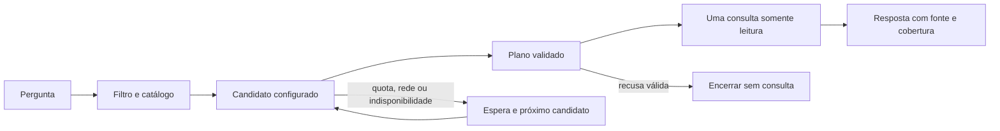

# Contingência de modelos para perguntas de compras públicas

## O que resolve

Uma quota ou indisponibilidade do planejador não precisa provocar repetição sem limite nem mudar
os dados consultados. O modo `fallback` tenta candidatos explícitos, registra a decisão e executa
no máximo uma ferramenta de negócio. O modelo escolhe uma consulta; os números vêm do PostgreSQL.

## Configuração padrão e situação real

| Candidato | Serviço/modelo | Padrão | Evidência atual |
| --- | --- | --- | --- |
| `groq-qwen` | Groq · Qwen3.8 27B | Primeiro | Corpus de contingência: 40 planos suportados aprovados; 20 recusas locais. O contrato anterior teve oito recusas indevidas, preservadas no histórico. |
| `groq-gpt-oss` | Groq · GPT-OSS 20B | Reserva de modelo | Três perguntas reais aprovadas; troca controlada para ele também funcionou. Não usa chave da OpenAI. |
| `openrouter-xing` | OpenRouter · Xing4.0 29B A4B `:free` | Reserva de outro serviço | Dois casos aprovados e um interrompido por 429. Disponibilidade variável; rastreio não concluído naquela rodada. |
| `gemini` | Google · Gemini 2.5 Flash | Reserva, respeitando espera registrada | A quota diária gratuita de 20 requisições foi observada. Há testes históricos com o contrato anterior; não herda a aprovação do novo contrato. |
| `ollama-qwen` | Local · Qwen3 4B | Desativado | Implementado, sem instalação, download ou teste real nesta entrega. |
| `openrouter-gemma` | Gemma 4 26B A4B `:free` | Desativado | Tentativas receberam 429; não validado. |
| `openrouter-nemotron` | Nemotron 3.5 Super VL `:free` | Desativado | Houve recusa indevida e falha 502, além de truncamento em configuração anterior. |
| `openrouter-liquid` | LFM 2.5 2.6B `:free` | Desativado | Raciocínio obrigatório no catálogo; pedido incompatível e saída truncada no orçamento testado. |
| `openrouter-qwen` | Qwen3.8 27B `:free` | Desativado | A variante aparecia na página de referência, mas não no catálogo API consultado; retornou 404. |

A ordem, `enabled` e os limites ficam em [`config/providers.json`](../config/providers.json).
Os IDs e destinos admitidos são revisados em código. Não há escolha aleatória de modelo, URL
fornecida pelo usuário ou troca automática para variante paga.

## Chaves em arquivo

As chaves já configuradas permanecem somente no `.env` local, ignorado pelo Git:

```dotenv
GROQ_API_KEY=chave_da_sua_conta_groq_free
OPENROUTER_API_KEY=chave_da_sua_conta_openrouter
GEMINI_API_KEY=chave_google_opcional
```

Manter a Groq no plano Free é uma condição da conta, não algo que o código consegue auditar.
No OpenRouter, o adaptador admite apenas IDs revisados `:free` e exige preço máximo zero para
entrada, saída e requisição. O campo `free_only` representa essa política de catálogo; não é
uma comprovação de faturamento de todas as contas. Não foi configurado pagamento ou upgrade.
Quotas, capacidade e disponibilidade podem mudar. O custo monetário não foi verificado.

## Executar

```powershell
.venv/Scripts/python.exe -m asktrace.agent "Qual é o resumo da cobertura?" --provider fallback --coverage runs/contracts-resume-c1345679-59ea-49ad-af35-be2cc924ceab/coverage.json
```

O padrão da CLI continua `baseline`, explicitamente sem LLM. Para testar somente um candidato,
usar `--provider groq-qwen`, `groq-gpt-oss` ou `openrouter-xing`. Esses modos individuais não trocam
para outro candidato: mantêm os testes dos modelos separados da avaliação da contingência.
`--provider gemini` preserva o adaptador individual existente; a espera persistente do pool é usada
em `fallback` e nos novos candidatos. Não usar o modo individual para insistir contra uma quota conhecida.

## Regras de troca



- Até três tentativas externas por pergunta; orçamento de planejamento de 60 segundos, verificado
  entre chamadas e antes de aceitar um plano; timeout por pedido de até 20 segundos.
- Rede, HTTP 408/429/500/502/503/504 permitem contingência. HTTP 404 coloca apenas o candidato
  em espera e permite testar outro modelo. Autenticação 401/403, parâmetro inválido ou plano fora
  do esquema encerram a pergunta para correção; não são escondidos por outro modelo.
- Uma recusa válida encerra o fluxo. Não buscamos outro modelo para forçar uma resposta.
- Quota 429 coloca o provedor inteiro em espera. Não multiplicamos uma quota compartilhada
  alternando modelos da mesma conta. O tempo informado pelo provedor é respeitado; na ausência
  dele, a espera conservadora é dez minutos. Outras falhas transitórias usam 30 segundos.
- Candidatos desativados, sem chave ou em espera são pulados sem chamada externa e sem gastar
  o orçamento de tentativas. Se nenhum responder, o resultado é erro explícito, sem resposta inventada
  nem fallback oculto para o baseline.

O prazo de planejamento não é um SLA global de resposta: leitura de arquivos, consultas SQL e
comportamento de rede do sistema operacional têm limites próprios. Cada consulta continua com
transação de leitura, SQL fixo parametrizado e login `asktrace_reader`. Não há permissão de escrita
adicionada aos modelos. Apenas pergunta e contrato de roteamento são enviados ao planejador.

O estado de espera fica em `data/runtime/provider-health.json`, com substituição atômica e fora do Git.
Erros diários Gemini registrados nas avaliações anteriores inicializam a espera sem nova chamada.
Apagar esse estado não renova quotas. O uso atual é CLI serial; não há garantia de coordenação
distribuída entre várias instâncias, e a interface pública ainda não foi implementada.

## Adequação e rastreabilidade

O contrato compartilhado está em [`asktrace/planning.py`](../asktrace/planning.py). A revisão v2
esclarece o recorte padrão, cidade/município, campos agregados e origem de uma compra. Não contém
os números das respostas. O modelo não precisa conhecer o banco para escolher a ferramenta.
Groq usa JSON com esquema estrito. Gemma experimental usa modo JSON e validação local, mas está
desativado. Em todos os casos, a aplicação rejeita campos extras, ação desconhecida e ID inventado.

O rastro registra candidato, serviço, modelo solicitado, falha/salto/seleção, configuração por hash,
metadados numéricos de uso e número de tentativas. A mudança de modelo é visível. Chaves, mensagens
HTTP completas e texto livre dos registros não entram no rastro. O upstream do OpenRouter pode
variar; não afirmamos identidade de hardware ou pesos a partir do ID solicitado.

## Evidências

- [Conferência dos 60 casos e oito adicionais](../runs/provider-verification-6f377e0f-a72c-4fc3-92ab-e225d79a95e1/verification.json).
- [Segmento 1–10](../runs/agent-eval-00419514-804c-44b4-a62b-fa32633e4094/evaluation.json)
  e [segmento 11–60](../runs/agent-eval-b53dbffa-b055-40f8-8b72-77aef201835f/evaluation.json):
  mesma configuração, código, corpus e cobertura; 60 casos distintos, 60 aprovados.
- [Oito perguntas adicionais](../runs/agent-eval-69298927-ccd7-4016-99d9-8816a7c91833/evaluation.json):
  oito aprovadas, congeladas antes da primeira execução; mesmo autor, não um benchmark independente.
- [GPT-OSS com contrato v2](../runs/agent-eval-da4ee542-8145-4ad2-babf-90d70b187da0/evaluation.json): 3/3.
- [OpenRouter Xing](../runs/agent-eval-083cd9fe-502f-41e8-bec3-41513bfaee5b/evaluation.json): 2/3, com 429.
- [Troca controlada para GPT-OSS](../runs/provider-failover-21f263db-11d8-49eb-8d85-1d57c72afd33/verification.json):
  primeiro 404 injetado antes da rede, uma chamada real ao GPT-OSS e uma consulta real de leitura.
  Não é evidência de uma indisponibilidade real da Groq.
- [Catálogo e contadores minimizados](../runs/provider-review-77d5f4cf-f8e1-4087-b451-5e744091beb4/openrouter-catalog.json).

No corpus principal foram 40 chamadas de planejador (todas selecionaram Qwen) e 20 recusas locais.
O resultado mede o fluxo com um corpus de desenvolvimento, não sessenta inferências do LLM nem
uma estimativa de generalização. Os modelos de reserva não herdam essa pontuação. A primeira
medição Qwen com o catálogo anterior foi 52/60; ela foi preservada, sem editar o corpus para melhorar
a nota. A avaliação v2 é consequência de ajuste sobre dados de desenvolvimento.

O código atual passou em **79 testes locais**, incluindo PostgreSQL. Entre eles: orçamento de
tentativas, espera compartilhada, autenticação terminal, plano inválido, recusa sem troca, endpoint
fixo, chave fora da URL, uma consulta por pergunta e prazo de planejamento. Ruff e formatação foram
verificados. CI remoto não foi verificado nesta entrega.

## Reproduzir a troca controlada

```powershell
.venv/Scripts/python.exe -m scripts.verify_provider_failover
```

Esse comando simula um 404 do primeiro modelo antes da rede e faz uma chamada real de reserva.
Usa estado temporário, respeita esperas reais existentes e não modifica a saúde de produção.
O relatório distingue tentativas lógicas da chamada externa real. Também depende de banco e quota.

## Bytes de execução e Git no Windows

Alguns JSON antigos foram executados com CRLF e publicados pelo Git com LF. Os relatórios já
publicados continuam idênticos ao HEAD. Os bytes antigos foram preservados em arquivos por SHA-256,
com [mapa de proveniência](../runs/evidence-byte-provenance-412a1cc6-2875-4a33-95d6-152a4ec7626d/manifest.json), sem alterar o conteúdo JSON.
O resolvedor aceita somente equivalência de quebras de linha e verifica hash e diretório do arquivo;
não aceita números ou campos alterados. Isso preserva a compatibilidade com os hashes no PostgreSQL.

Novas evidências em `runs/` não passam por conversão de texto do Git. Avaliações futuras salvam
`corpus.source.json` antes de chamar o modelo. Os corpora editáveis ficam em LF. Para conferir o hash
de execução de um registro histórico:

```powershell
.venv/Scripts/python.exe -m asktrace.evidence runs/agent-eval-6de25618-3cbe-4252-95ab-4620422340e8/evaluation.json
```

O utilitário mostra separadamente hash dos bytes de execução e dos bytes publicados. Não reconstrói
JSON a partir dos valores para fingir um hash: lê a cópia exata preservada. Os testes incluem CRLF,
arquivo alterado e caminho de arquivo fora do diretório permitido.

Referências consultadas: [Groq: esquemas JSON](https://console.groq.com/docs/structured-outputs),
[Groq: plano Free](https://console.groq.com/docs/billing-faqs),
[OpenRouter: preço máximo](https://openrouter.ai/docs/guides/routing/provider-selection),
[OpenRouter: saída estruturada](https://openrouter.ai/docs/guides/features/structured-outputs).
